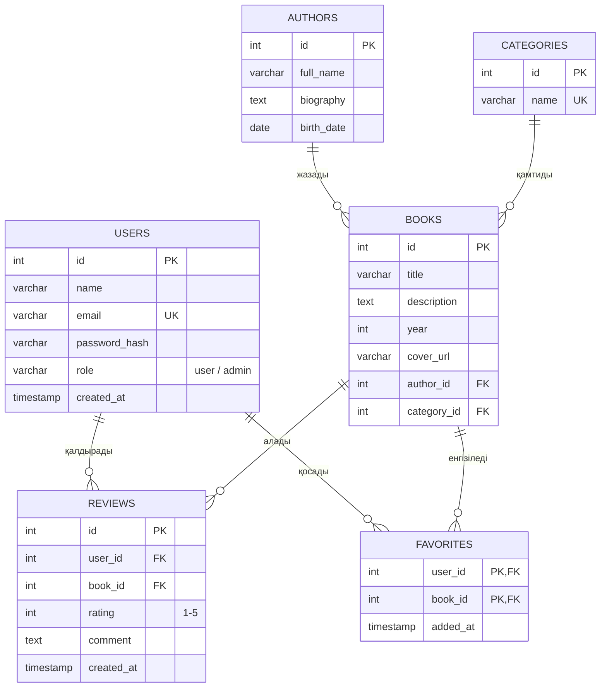

# 📚 BookShelf — Онлайн кітапхана

## Жоба туралы

**BookShelf** — пайдаланушыларға кітаптарды іздеуге, оқуға, бағалауға және өзінің жеке кітап тізімін жүргізуге мүмкіндік беретін веб-қосымша.

### Жобаның мақсаты

Оқырмандарға кітаптарды бір жерден оңай табуға, олар туралы пікір алмасуға және оқыған кітаптарын жүйелеуге ыңғайлы платформа жасау.
### Негізгі мүмкіндіктер

- 🔐 Тіркелу және жүйеге кіру
- 🔎 Кітаптарды атауы, авторы және санаты бойынша іздеу
- 📖 Кітап туралы толық ақпаратты көру (сипаттама, автор, жыл, рейтинг)
- ⭐ Кітапқа баға қою және пікір қалдыру
- ❤️ Кітаптарды «Таңдаулылар» тізіміне қосу
- 👤 Жеке кабинет (профиль, таңдаулы кітаптар, жазылған пікірлер)
- 🛠️ Әкімші панелі (кітап, автор, санат қосу/өзгерту/жою)
- 📱 Адаптивті дизайн (компьютер, планшет, телефон)

### Қолданылатын технологиялар

| Бөлім | Технология |
|---|---|
| Frontend | HTML5, CSS3, JavaScript |
| Backend | Node.js (Express) |
| Дерекқор | PostgreSQL |
| Нұсқаларды басқару | Git, GitHub |

---

## Беттер тізімі

| № | Бет | Сипаттамасы | Негізгі функциялар |
|---|---|---|---|
| 1 | **Басты бет** (`index.html`) | Сайтқа кіріспе бет | Танымал және жаңа кітаптар, іздеу жолағы, санаттар |
| 2 | **Тіркелу** (`register.html`) | Жаңа пайдаланушыны тіркеу | Аты, email, құпиясөз енгізу, деректерді тексеру |
| 3 | **Кіру** (`login.html`) | Жүйеге кіру | Email және құпиясөз арқылы кіру |
| 4 | **Кітаптар каталогы** (`catalog.html`) | Барлық кітаптар тізімі | Іздеу, санат/автор бойынша сүзгілеу, сұрыптау |
| 5 | **Кітап беті** (`book.html`) | Бір кітап туралы толық ақпарат | Сипаттама, рейтинг, пікірлер, таңдаулыларға қосу |
| 6 | **Жеке кабинет** (`profile.html`) | Пайдаланушы профилі | Профильді өзгерту, таңдаулы кітаптар, менің пікірлерім |
| 7 | **Әкімші панелі** (`admin.html`) | Сайтты басқару | Кітап, автор, санат қосу/өзгерту/жою |
| 8 | **Біз туралы** (`about.html`) | Жоба туралы ақпарат | Сипаттама, байланыс деректері |

---

## Дерекқор құрылымы (ER-диаграмма)



### Кестелер арасындағы байланыстар

- **AUTHORS → BOOKS** (бір-көп): бір автордың бірнеше кітабы болуы мүмкін.
- **CATEGORIES → BOOKS** (бір-көп): бір санатта бірнеше кітап болады.
- **USERS → REVIEWS** (бір-көп): бір пайдаланушы бірнеше пікір жаза алады.
- **BOOKS → REVIEWS** (бір-көп): бір кітапқа бірнеше пікір қалдырылады.
- **USERS ↔ BOOKS** (көп-көп) `FAVORITES` кестесі арқылы: пайдаланушы көп кітапты таңдаулыға қоса алады, бір кітап көп пайдаланушының таңдаулысында болады.

---

## Жоба құрылымы

```
bookshelf/
├── README.md
├── frontend/
│   ├── index.html
│   ├── login.html
│   ├── register.html
│   ├── catalog.html
│   ├── book.html
│   ├── profile.html
│   ├── css/
│   │   └── style.css
│   ├── js/
│   │   └── main.js
│   └── images/
├── backend/
│   └── server.js
└── docs/
└── er-diagram.png
```

## Жобаны іске қосу

```bash
git clone https://github.com/kenesovazhanel806-oss/bookshelf.git
cd bookshelf/frontend
```

Содан кейін `index.html` файлын браузерде ашыңыз.

## Жұмыс жоспары

- [x] **8-апта:** Жоспарлау, репозиторий құру, README, беттер тізімі, ER-диаграмма
- [ ] **9-апта:** Frontend — негізгі беттердің макеті және статикалық беттер
- [ ] Келесі апталар: Backend, дерекқорды қосу, тестілеу

## Авторы

**Аты-жөні:** _____________
**Тобы:** _____________
